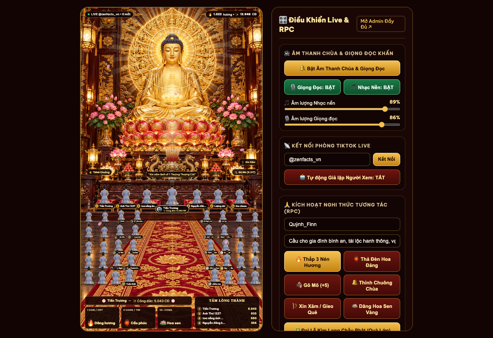
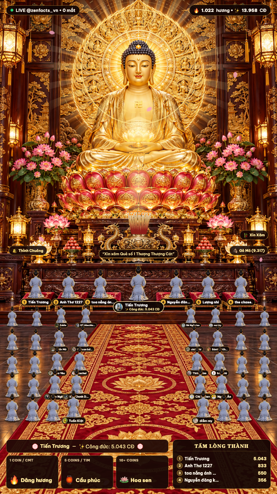
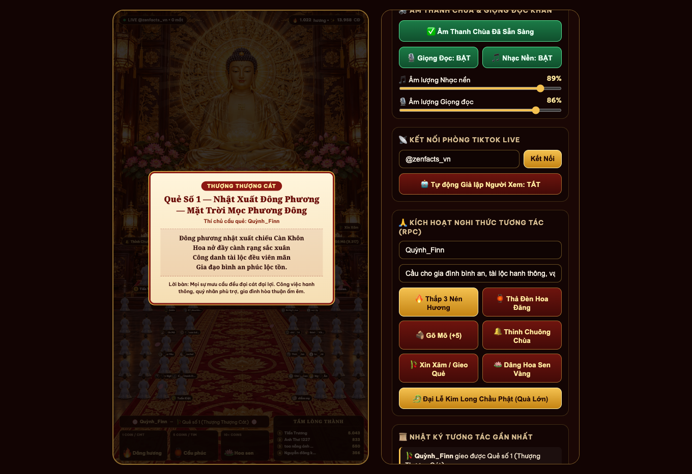
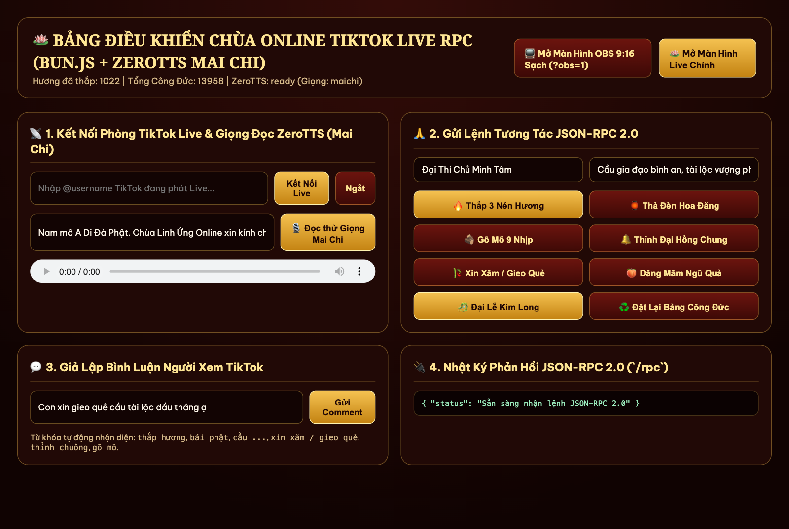

# 🪷 Chùa Linh Ứng Online — TikTok Live RPC

> **Hệ thống phát trực tiếp tương tác Chùa Online (Interactive TikTok Live Sanctuary & JSON-RPC 2.0)** chuẩn khung hình dọc **9:16 (`1080×1920`)** dành cho **OBS Studio** / **TikTok Live Studio**. Chạy siêu nhẹ trên **Bun.js** và tích hợp giọng đọc AI tiếng Việt **ZeroTTS (`zeroweight-ai/ZeroTTS`)** hoàn toàn ngoại tuyến (offline).

[](https://bun.sh/)
[](https://python.org/)
[](https://github.com/zeroweight-ai/ZeroTTS)
[](https://www.jsonrpc.org/specification)
[](#-hướng-dẫn-cấu-hình-obs-studio)
[](#-chạy-bằng-docker-compose)

---

## 📑 Mục Lục
- [1. Giới Thiệu Tổng Quan](#-giới-thiệu-tổng-quan)
- [2. Các Tính Năng & Nghi Thức Tâm Linh](#-các-tính-năng--nghi-thức-tâm-linh)
- [3. Giao Diện Thực Tế](#-giao-diện-thực-tế)
- [4. Bảng Quy Tắc Tương Tác TikTok Live](#-bảng-quy-tắc-tương-tác-tiktok-live)
- [5. Hướng Dẫn Cài Đặt & Khởi Chạy](#-hướng-dẫn-cài-đặt--khởi-chạy)
  - [Cài đặt thủ công (Khuyến nghị)](#1-cài-đặt-thủ-công-khuyến-nghị)
  - [Chạy bằng Docker Compose](#2-chạy-bằng-docker-compose)
  - [Mô hình AI ZeroTTS Offline](#3-mô-hình-ai-zerotts-offline--danh-sách-giọng-đọc)
- [6. Hướng Dẫn Cấu Hình OBS Studio](#-hướng-dẫn-cấu-hình-obs-studio)
- [7. Đặc Tả Giao Thức JSON-RPC 2.0](#-đặc-tả-giao-thức-json-rpc-20)
- [8. Kiến Trúc Kỹ Thuật & Tối Ưu Hiệu Năng](#-kiến-trúc-kỹ-thuật--tối-ưu-hiệu-năng)
- [9. Cấu Trúc Thư Mục](#-cấu-trúc-thư-mục)
- [10. Xử Lý Sự Cố Thường Gặp (FAQ)](#-xử-lý-sự-cố-thường-gặp-faq)

---

## 🌟 Giới Thiệu Tổng Quan

Hệ thống kết nối trực tiếp phòng TikTok Live đang phát thông qua `tiktok-live-connector`, phân tích cú pháp thời gian thực các sự kiện **Comment, Like, Share, Follow, Gift** và ánh xạ thành các nghi thức cúng dường Phật giáo trên màn hình Chánh Điện **Đức Phật A Di Đà**.

Đồng thời, hệ thống cung cấp giao diện quản trị 3 cột trực quan (Cấu hình • JSON • Màn Live) và cổng **JSON-RPC 2.0** (`HTTP POST /rpc` & `ws://localhost:3000/ws`), cho phép tích hợp linh hoạt với **TikFinity**, **Streamer.bot**, webhook ngoài hoặc điều khiển thủ công.

---

## 📿 Các Tính Năng & Nghi Thức Tâm Linh

1. **Thắp Hương & Đảnh Lễ Tam Bái (8-Frame Sprite Animation)**:
   - Khi có thí chủ thắp nhang, nhân vật Phật tử áo lam xuất hiện, bước từng bước dọc thảm hoa sen lên trước Lư Hương Đỉnh Đồng.
   - Phật tử hạ gối quỳ và đảnh lễ ngũ thể đầu địa 3 lạy hướng về kim thân Đức Phật A Di Đà.
   - Đầu nén nhang cháy đỏ, số lượng nén nhang trên bàn thờ tăng tương ứng theo công đức.

2. **Thả Đèn Hoa Đăng / Sớ Cầu Nguyện (AI Voice Đọc Lời Khấn)**:
   - Bình luận chứa lời nguyện ước được đính kèm avatar, tên thí chủ bay lên thành Đèn Hoa Đăng tỏa sáng.
   - Giọng AI ZeroTTS (mặc định giọng nữ nhẹ nhàng Mai Chi) đọc tên thí chủ và lời chúc phúc/cầu nguyện với hiệu ứng tự động hạ nhạc nền (audio ducking).

3. **Xin Xăm & Gieo Quẻ Đầu Năm (Đồng Bộ Giọng Đọc & Tờ Giải Quẻ)**:
   - Ống xăm trên bàn thờ rung lắc vật lý khi có yêu cầu xin quẻ.
   - Tờ Linh Xăm (trong bộ 18 quẻ tuyển chọn: Thượng Thượng Cát, Đại Cát, Thượng Cát, Trung Cát...) bung mở trên màn hình ngay thời điểm giọng đọc vang lên, hiển thị bài thơ tứ tuyệt, ý nghĩa và lời khuyên tu tập.

4. **Gõ Mõ Tâm Kinh & Thỉnh Đại Hồng Chung**:
   - Thả tim kích hoạt dùi gõ mõ nhịp nhàng, hiện chữ `+1 Công Đức` bay lên.
   - Follow/Chia sẻ thỉnh Đại Hồng Chung ngân vang với sóng âm vàng lan tỏa khắp Chánh Điện, kích hoạt toàn bộ 40+ Phật tử trong Đạo Tràng đồng loạt cúi lạy.

5. **Bảng Vàng Công Đức & 6 Đệm Quỳ VIP**:
   - Tự động thống kê và vinh danh những thí chủ có điểm công đức cao nhất.
   - 6 thí chủ dẫn đầu được đặt tên và avatar trực tiếp lên 6 đệm quỳ gấm đỏ phía trước bàn thờ Phật.

6. **Chế Độ Giả Lập Tự Động (Auto-Simulation Engine)**:
   - Tự động sinh ngẫu nhiên các thí chủ hữu duyên bái Phật, gõ mõ, thắp hương để giữ nhiệt phòng live khi mới mở hoặc lúc vắng người xem.

---

## 📸 Giao Diện Thực Tế

### 1. Bảng Quản Trị 3 Cột Tổng Hợp (`http://localhost:3000`)
Màn hình trung tâm: Cột trái (Cấu hình & TikTok Connect) • Cột giữa (Nhật ký JSON-RPC & Lệnh nhanh) • Cột phải (Khung live 9:16 thời gian thực).


### 2. Màn Hình OBS 9:16 Sạch (`?obs=1`) & Modal Giải Quẻ Linh Xăm
| Màn hình OBS 9:16 (`/live?obs=1`) | Tờ Giải Quẻ Linh Xăm (Đồng bộ Giọng Đọc) |
| :---: | :---: |
|  |  |

### 3. Bảng Điều Khiển JSON-RPC 2.0 & Giả Lập (`http://localhost:3000/admin`)


---

## 🎮 Bảng Quy Tắc Tương Tác TikTok Live

| Sự kiện TikTok Live | Điều kiện / Cú pháp nhận diện | Nghi thức Chánh Điện | Điểm Công Đức |
| :--- | :--- | :--- | :---: |
| **Thả tim (Like)** | Mỗi đợt thả tim từ người xem | Gõ mõ gỗ tụng kinh + Làn sóng Phật tử cúi lạy | `+1` / tim |
| **Follow / Share** | Người xem bấm Theo dõi hoặc Chia sẻ | Thỉnh Đại Hồng Chung ngân vang + Sóng âm vàng | `+10` |
| **Bình luận Thắp hương** | `thắp hương`, `dâng hương`, `bái phật`, `lạy phật`, `cúng phật` | Phật tử bước lên thảm đỏ, quỳ lạy 3 lạy + Thắp hương + Giọng đọc cảm tạ | `+15` |
| **Bình luận Cầu nguyện** | `cầu ...`, `nguyện ...`, `nam mô`, `a di đà phật`, `bình an`, `chúc ...` | Phật tử đảnh lễ + Thả Đèn Hoa Đăng bay lên trời + Giọng đọc lời cầu khấn | `+10` |
| **Bình luận Xin xăm** | `xin xăm`, `gieo quẻ`, `rút quẻ`, `xin quẻ`, `quẻ` | Lắc ống xăm + Mở tờ Giải Quẻ đồng bộ khớp giọng đọc AI | `+10` |
| **Tặng quà Nhỏ (1–4 xu)** | Hoa hồng (Rose), Heart Me, Cánh hoa... | Dâng Đài Sen Vàng + Thắp 3 nén hương + Đọc tên cảm tạ | `+20` / xu |
| **Tặng quà Vừa (5–99 xu)** | Đèn lưu ly, Nước hoa, Quạt giấy... | Dâng Đèn Lưu Ly / Mâm Ngũ Quả + Thỉnh Chuông + Đọc lời chúc phúc | `+30` / xu |
| **Tặng quà Lớn (≥ 100 xu)** | Kim Long, Vương miện, Thiên nga, Lâu đài... | **Đại Lễ Kim Long Chầu Phật**: Mưa hoa sen vàng, Hào quang vạn trượng, Chuông đồng rền vang | `+50` / xu |

---

## 🚀 Hướng Dẫn Cài Đặt & Khởi Chạy

### 1. Cài đặt thủ công (Khuyến nghị)

#### Yêu cầu môi trường:
- **[Bun.js](https://bun.sh/)** (`>= 1.1`)
- **Python** (`>= 3.10`)
- **[uv](https://github.com/astral-sh/uv)** (trình quản lý gói Python siêu tốc) hoặc `python3-venv`
- **ffmpeg** (thư viện xử lý giải mã âm thanh hệ thống)

#### Bước 1: Cài đặt dependencies Node/Bun
```bash
bun install
```

#### Bước 2: Thiết lập môi trường Python cho ZeroTTS
```bash
# Tạo virtual environment .venv
uv venv .venv

# Cài đặt thư viện ZeroTTS và Pillow
uv pip install --python .venv/bin/python zerotts pillow

# (Nếu dùng pip thông thường: python3 -m venv .venv && .venv/bin/pip install zerotts pillow)
```

#### Bước 3: Khởi chạy ứng dụng
```bash
# Chạy production:
bun start

# Hoặc chạy dev với chế độ auto-reload khi sửa file:
bun run dev
```

Mặc định máy chủ lắng nghe tại cổng `3000`:
- **Giao diện điều khiển tổng hợp 3 cột**: [http://localhost:3000](http://localhost:3000)
- **Màn hình Chánh Điện độc lập**: [http://localhost:3000/live](http://localhost:3000/live)
- **Màn hình chuẩn OBS Studio Browser Source**: [http://localhost:3000/live?obs=1](http://localhost:3000/live?obs=1)

---

### 2. Chạy bằng Docker Compose

Hệ thống đã có sẵn `Dockerfile` đa tầng và `docker-compose.yml` tích hợp sẵn Bun.js, Python 3 và thư viện ZeroTTS:

```bash
# Khởi động dịch vụ nền:
docker compose up -d --build

# Theo dõi nhật ký thời gian thực:
docker compose logs -f

# Dừng dịch vụ:
docker compose down
```

Các thư mục dữ liệu như `data/` (Bảng Vàng Công Đức, cache WAV) và `models/` (Model ZeroTTS ONNX) được mount trực tiếp ra ngoài máy chủ để dữ liệu luôn được lưu trữ an toàn.

---

### 3. Mô hình AI ZeroTTS Offline & Danh Sách Giọng Đọc

Thư mục `models/zerotts/` trong dự án đã lưu sẵn toàn bộ ONNX runtime weights và danh mục giọng nói. Khi `tts_worker.py` khởi chạy, hệ thống sẽ ưu tiên đọc model trực tiếp từ thư mục `models/zerotts/` nội bộ mà **không cần kết nối Internet ra HuggingFace**.

#### 8 Giọng AI Tiếng Việt tích hợp:
- **`maichi`** *(Mặc định)*: Giọng nữ Mai Chi nhẹ nhàng, ấm áp, truyền cảm hứng tâm linh.
- **`baotrang`**: Giọng nữ Bảo Trang thanh thoát, nhịp điệu chậm rãi.
- **`giahuy`**: Giọng nam Gia Huy đĩnh đạc, trầm ấm.
- **`hamy`**: Giọng nữ Hà My trẻ trung, tươi tắn.
- **`huuduc`**: Giọng nam Hữu Đức trang nghiêm, vang sáng.
- **`kimoanh`**: Giọng nữ Kim Oanh êm dịu, rõ âm vần.
- **`quangminh`**: Giọng nam Quang Minh chuẩn giọng đọc miền Bắc.
- **`tiendat`**: Giọng nam Tiến Đạt mạch lạc, tự nhiên.

Bạn có thể thay đổi giọng đọc bất kỳ lúc nào qua Bảng điều khiển Admin hoặc qua RPC:
```bash
curl -X POST http://localhost:3000/rpc \
  -H "Content-Type: application/json" \
  -d '{"jsonrpc":"2.0","id":1,"method":"temple.updateSettings","params":{"ttsVoice":"kimoanh"}}'
```

---

## 📺 Hướng Dẫn Cấu Hình OBS Studio

Để đưa màn hình Chánh Điện vào phần mềm phát sóng trực tiếp (**OBS Studio**, **TikTok Live Studio**, **Prism Live Studio**):

1. Mở **OBS Studio**, tại khung **Sources** (Nguồn), bấm dấu `+` chọn **Browser** (Trình duyệt).
2. Thiết lập thông số:
   - **URL**: `http://localhost:3000/live?obs=1` *(hoặc `http://<IP_MÁY_CHỦ>:3000/live?obs=1` nếu chạy khác máy)*.
   - **Width (Rộng)**: `1080`
   - **Height (Cao)**: `1920`
   - **FPS**: `30` *(đạt chuẩn mượt và tiết kiệm GPU)*.
3. Tùy chọn âm thanh:
   - Tích chọn **Control audio via OBS** (Kiểm soát âm thanh qua OBS) nếu muốn điều chỉnh âm lượng Chùa Online trực tiếp trên bàn mixer của OBS.
4. Bấm **OK**. Màn hình Chánh Điện Đức Phật A Di Đà sẽ hiển thị toàn màn hình chuẩn tỷ lệ 9:16 không viền, sẵn sàng livestream.

---

## 🔌 Đặc Tả Giao Thức JSON-RPC 2.0

Hệ thống tiếp nhận yêu cầu qua 2 kênh:
- **HTTP POST**: `http://localhost:3000/rpc` (Headers: `Content-Type: application/json`)
- **WebSocket**: `ws://localhost:3000/ws`

### Danh sách Phương Thức (Methods):

| Method | Mô tả | Tham số (`params`) |
| :--- | :--- | :--- |
| `temple.getState` | Lấy toàn bộ trạng thái phiên live, nhang đèn và Bảng Vàng | *(không cần)* |
| `temple.burnIncense` | Thực hiện thắp nhang và bước lên đảnh lễ 3 lạy | `user`, `avatar`, `count`, `wish`, `uniqueId` |
| `temple.sendPrayer` | Thả Đèn Hoa Đăng mang lời ước bay lên trời | `user`, `avatar`, `wish`, `readTts` |
| `temple.drawFortune` | Lắc ống xăm và mở tờ Giải Quẻ linh ứng | `user`, `avatar`, `topic` |
| `temple.strikeWoodenFish` | Gõ mõ gỗ tụng kinh tích điểm công đức | `user`, `count` |
| `temple.ringBell` | Thỉnh Đại Hồng Chung ngân vang | `user`, `count`, `wish` |
| `temple.offerGift` | Dâng lễ vật cúng Phật (`lotus`, `fruit`, `lamp`, `dragon`) | `user`, `avatar`, `giftType`, `coins`, `giftName` |
| `temple.grandCeremony` | Kích hoạt Đại Lễ Kim Long Chầu Phật | `user`, `avatar`, `giftName`, `coins` |
| `temple.speak` | Phát âm thanh đọc câu nói bất kỳ qua ZeroTTS | `text`, `voice`, `broadcast` |
| `temple.ttsStatus` | Kiểm tra tình trạng hoạt động của worker ZeroTTS | *(không cần)* |
| `temple.updateSettings` | Cập nhật cấu hình âm thanh, hiệu ứng, giọng đọc | `ttsEnabled`, `ttsVoice`, `bgMusicEnabled`, `sfxEnabled`, `smokeDensity`, `autoSim` |
| `temple.resetMerit` | Đặt lại điểm số và danh sách Bảng Vàng Công Đức | *(không cần)* |
| `live.connect` | Kết nối tới phòng TikTok Live của một tài khoản | `username` (ví dụ: `"@zenfacts_vn"`) |
| `live.disconnect` | Ngắt kết nối phòng TikTok Live hiện tại | *(không cần)* |
| `live.setAutoSim` | Bật hoặc tắt chế độ người xem giả lập tự động | `enabled` (boolean: `true` / `false`) |

### Ví dụ Lệnh `curl`:

#### 1. Thắp 3 nén hương cầu an:
```bash
curl -X POST http://localhost:3000/rpc \
  -H "Content-Type: application/json" \
  -d '{
    "jsonrpc": "2.0",
    "id": 1,
    "method": "temple.burnIncense",
    "params": {
      "user": "Thí Chủ Diệu Tâm",
      "count": 3,
      "wish": "Cầu gia đạo bình an, tai qua nạn khỏi"
    }
  }'
```

#### 2. Thỉnh Đại Hồng Chung:
```bash
curl -X POST http://localhost:3000/rpc \
  -H "Content-Type: application/json" \
  -d '{
    "jsonrpc": "2.0",
    "id": 2,
    "method": "temple.ringBell",
    "params": {
      "user": "Phật Tử Minh Tuệ",
      "count": 1,
      "wish": "Nguyện tiêu trừ nghiệp chướng"
    }
  }'
```

#### 3. Kết nối phòng TikTok Live:
```bash
curl -X POST http://localhost:3000/rpc \
  -H "Content-Type: application/json" \
  -d '{
    "jsonrpc": "2.0",
    "id": 3,
    "method": "live.connect",
    "params": {
      "username": "@zenfacts_vn"
    }
  }'
```

---

## ⚡ Kiến Trúc Kỹ Thuật & Tối Ưu Hiệu Năng

```text
               ┌────────────────────────────────────────────────────────┐
               │                   TIKTOK LIVE STREAM                   │
               └──────────────────────────┬─────────────────────────────┘
                                          │ Webcast WebSocket
                                          ▼
                      ┌──────────────────────────────────────┐
                      │    server.js (Bun.js 1.1+ Engine)    │
                      │  - tiktok-live-connector             │
                      │  - Bộ lọc Spam / Cuneiform / Zalgo   │
                      │  - State Machine & Merit Manager     │
                      │  - JSON-RPC 2.0 Router & WS Broker   │
                      └───────┬──────────────────────┬───────┘
                              │                      │
       IPC stdio JSON pipe    │                      │  WebSocket Broadcast
                              ▼                      ▼
  ┌──────────────────────────────────────┐  ┌─────────────────────────────────┐
  │   tts_worker.py (ZeroTTS 48kHz)      │  │      Giao Diện OBS Live 9:16     │
  │ - ONNX Runtime (3 Threads, Passive)  │  │ - 8-Frame Prostration Sprite    │
  │ - Single-pass synthesis (0.0% idle)  │  │ - 30 FPS Offscreen Particles    │
  │ - Anti-clipping & Cosine Fade        │  │ - Web Audio Synth & Audio Duck  │
  └──────────────────────────────────────┘  └─────────────────────────────────┘
```

- **Bun.js Event Loop**: Quản lý WebSocket hàng trăm kết nối client đồng thời với mức tiêu hao bộ nhớ thấp (`< 50MB RAM`).
- **Canvas 30 FPS Particle Engine (`particles.js`)**:
  - Khóa chặt ở 30 FPS với bộ đếm `requestAnimationFrame` điều hòa thời gian (`delta-time cap`).
  - Pre-render toàn bộ sprite khói hương, hạt bụi vàng và cánh hoa sen ra Offscreen Canvas lúc khởi động. Quá trình render từng frame chỉ gọi lệnh `drawImage()` tốc độ cao, không tính toán lại gradient phức tạp.
- **Zero-Flicker Sprite Prostration (`live.js`)**:
  - Nạp sẵn cả 8 frame động tác (`walk1`, `walk2`, `kneelDown`, `kneel`, `forehead`, `bowMid`, `prostrate`, `prostrateDeep`) vào bộ nhớ DOM từ đầu, chỉ đổi class hiển thị `active` để loại bỏ 100% hiện tượng chớp nháy trắng khi chuyển trạng thái.
- **ZeroTTS Worker Thường Trú (`tts_worker.py`)**:
  - Giao tiếp qua stdio pipe hai chiều (chuẩn JSON lines), cấu hình luồng tính toán `intra_op_num_threads=3` và `OMP_WAIT_POLICY=PASSIVE` giúp CPU trở về `0.0%` ngay sau khi tổng hợp xong câu đọc.
  - Tự động chuẩn hóa dấu câu tiếng Việt, cắt chuỗi thông minh tối đa 160 ký tự, khử DC offset và chèn Cosine Ramp làm mịn đầu/cuối sóng âm để không tạo tiếng "tách/rè".
- **Lưu Trữ Bền Vững Trạng Thái (`data/merit-state.json`)**:
  - Mọi thao tác tích lũy điểm công đức, lễ vật, số lượt thắp nhang đều tự động ghi vào đĩa theo cơ chế ghi trễ (`debounced write`) tránh thắt cổ chai I/O khi người xem thả tim dồn dập.

---

## 📁 Cấu Trúc Thư Mục

```text
├── server.js                  # Máy chủ HTTP & WebSocket JSON-RPC 2.0, TikTok Connector, Bộ lọc spam
├── tts_worker.py              # Worker Python chạy ZeroTTS offline 48kHz, khử rè âm thanh
├── package.json               # Cấu hình dependency Node/Bun
├── bun.lock                   # Lockfile chuẩn của Bun.js
├── Dockerfile                 # Image Docker đa tầng đóng gói Bun + Python + ZeroTTS
├── docker-compose.yml         # File khởi chạy container cùng persistent volume
├── CLAUDE.md                  # Hướng dẫn quy chuẩn kiến trúc dự án
├── .gitignore                 # Chặn commit node_modules, log, cache âm thanh
├── data/
│   ├── merit-state.json       # Lưu trữ bền vững dữ liệu Bảng Vàng và điểm Công Đức
│   └── tts-cache/             # Thư mục chứa các file .wav cache âm thanh sinh ra khi live
├── models/
│   └── zerotts/               # Trọng số model ZeroTTS ONNX và 8 giọng đọc tiếng Việt offline
├── public/
│   ├── index.html             # Bảng điều khiển Chánh Điện 3 cột (Admin + JSON + Màn Live)
│   ├── live.html              # Màn hình Chánh Điện độc lập 9:16 chuyên dụng cho OBS
│   ├── css/
│   │   └── live.css           # Toàn bộ hiệu ứng thị giác Chánh Điện và animation 2.5D
│   ├── js/
│   │   ├── live.js            # Điều phối logic Chánh Điện, sprite bái lạy & hàng đợi tương tác
│   │   ├── particles.js       # Hệ thống hạt khói hương, hoa sen, sóng âm 30 FPS siêu mượt
│   │   └── audio.js           # Tổng hợp tiếng Mõ, Chuông đồng qua Web Audio & quản lý ducking TTS
│   └── assets/                # Hình nền Chánh Điện Đức Phật A Di Đà và bộ 8 frame sprite Phật tử
└── docs/
    ├── demo/                  # Ảnh chụp màn hình demo các chế độ hiển thị
    └── superpowers/specs/     # Tài liệu đặc tả kỹ thuật chi tiết
```

---

## ❓ Xử Lý Sự Cố Thường Gặp (FAQ)

### 1. Tại sao âm thanh giọng đọc TTS không phát khi mở trên trình duyệt?
- **Nguyên nhân**: Chính sách tự động phát âm thanh (Autoplay Policy) của Google Chrome/Edge chặn âm thanh nếu người dùng chưa tương tác với trang web.
- **Khắc phục**: Nhấp chuột một lần vào bất kỳ vị trí nào trên trang web để mở khóa AudioContext. Khi chạy trên OBS Browser Source, âm thanh sẽ phát bình thường vì OBS cho phép autoplay tự do.

### 2. Gặp lỗi `ModuleNotFoundError: No module named 'zerotts'` khi khởi động server?
- **Nguyên nhân**: Môi trường Python `.venv` chưa được tạo hoặc chưa cài `zerotts`.
- **Khắc phục**: Chạy lệnh:
  ```bash
  uv venv .venv && uv pip install --python .venv/bin/python zerotts pillow
  ```
  `server.js` sẽ tự động tìm kiếm đường dẫn `.venv/bin/python` khi khởi chạy.

### 3. Không kết nối được tới phòng TikTok Live (`Connecting...` mãi)?
- **Nguyên nhân**: Tài khoản TikTok đó hiện tại **chưa phát trực tiếp (Offline)**, hoặc bị TikTok áp dụng hạn chế IP tạm thời.
- **Khắc phục**: Hãy kiểm tra trên ứng dụng TikTok trên điện thoại để chắc chắn tài khoản đang bật Live. Bạn có thể bật tính năng **Giả lập tự động (Auto-Simulation)** trong bảng Admin để hệ thống tự vận hành mà không cần phụ thuộc vào phòng Live thật.

### 4. Muốn đổi cổng chạy ứng dụng sang cổng khác (ví dụ: 8080)?
- Khởi chạy với biến môi trường `PORT`:
  ```bash
  PORT=8080 bun start
  ```

---

## 📄 Bản Quyền & Giấy Phép
Dự án được xây dựng phục vụ mục đích phát triển công nghệ livestream tương tác và cộng đồng. Phát hành theo giấy phép mã nguồn mở.
Mọi đóng góp (Pull Request, Issue) đều được chào đón nồng nhiệt! 🙏
